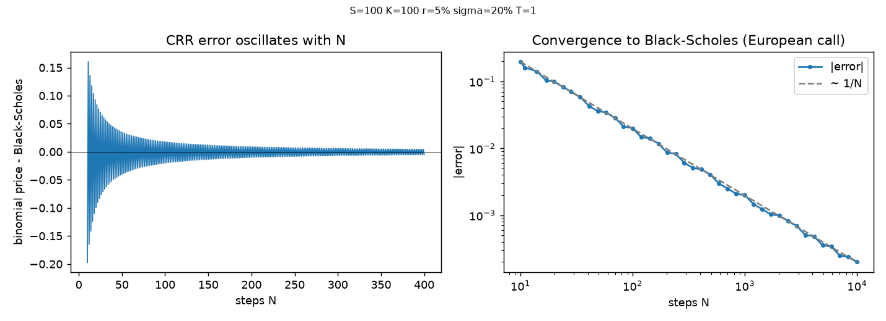
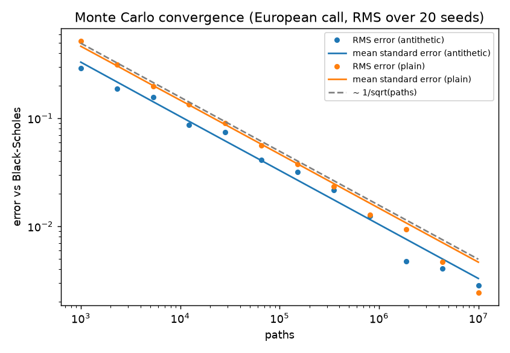

# Option Pricing Model

Three option pricers, Black-Scholes, Cox-Ross-Rubinstein binomial and Monte Carlo, written in a dependency-free C++17 core and re-implemented independently in Python. Both implementations are checked against the same set of golden test vectors, and the C++ core is exposed to Python through pybind11 for cross-checks, convergence plots and benchmarks.

Built as Project #4 (Option Pricing Model) of a quant-developer project list.

## What it prices

| Model | European | American | Greeks | Notes |
|---|:---:|:---:|---|---|
| Black-Scholes | yes | no | analytic delta, gamma, vega | closed form, used as ground truth |
| Binomial (CRR) | yes | yes | delta, gamma from tree nodes; vega by bump | early-exercise check at every node |
| Monte Carlo | yes | no | bump-and-reprice with common random numbers | seedable, antithetic variates, standard error and 95% CI |

Underlying model: one-factor geometric Brownian motion,
`S(t+dt) = S(t) * exp((r - q - sigma^2/2) dt + sigma sqrt(dt) Z)`, with constant risk-free rate `r`, constant volatility `sigma` and a continuous dividend yield `q`. Vega is reported per 1.00 change in sigma.

## Repository layout

```
optionpricer/
  core/        C++17 pricing library, no external dependencies
  bindings/    pybind11 module (optionpricer_cpp)
  python/      pure-Python reference (numpy only), tests, plots, benchmarks
  golden/      vectors.json, shared by the C++ and Python tests
  tests/core/  Catch2 tests for the C++ core
  docs/        design spec, implementation plan, results (plots, benchmarks)
```

## Build and test

Prerequisites: a C++17 compiler, CMake 3.16+, Python 3.10+ with `numpy`, `pytest` and `matplotlib` (`pip install numpy pytest matplotlib`). Catch2, nlohmann/json and pybind11 are fetched by CMake automatically.

### Linux / macOS

```bash
cmake -B build
cmake --build build
ctest --test-dir build --output-on-failure

PYTHONPATH=build python -m pytest python/tests -v
```

### Windows (Visual Studio / MSVC)

```powershell
cmake -B build
cmake --build build --config Release
ctest --test-dir build -C Release --output-on-failure

$env:PYTHONPATH = "build\Release"
$env:OPTIONPRICER_BUILD = "build\Release"
python -m pytest python/tests -v
```

### Plots and benchmarks

```bash
python python/tools/plot_convergence.py      # add --quick for a fast smoke run
python python/tools/benchmark.py
```

Outputs go to `docs/results/`.

## Results

### Correctness

Current status: 4 of 4 C++ test groups pass and 39 of 39 Python tests pass, including the cross-implementation tests that compare the C++ core with the independent Python reference on every golden case.

What the tests cover:

- Textbook prices (Hull example: S=42, K=40, r=10%, sigma=20%, T=0.5 gives call 4.76, put 0.81)
- Put-call parity, `C - P = S e^(-qT) - K e^(-rT)`, including with `q > 0` and a negative rate
- Binomial converges to Black-Scholes (1e-2 absolute at N = 5000)
- American put >= European put, American >= intrinsic value, American call = European call when `q = 0`
- Monte Carlo price within 3 standard errors of Black-Scholes at a fixed seed
- Greeks agree with Black-Scholes within documented tolerances (Monte Carlo bounds are deliberately loose because bump-and-reprice is noisy)
- Edge cases return finite values, never NaN: deep in/out-of-the-money, `T = 0`, `sigma = 0`, `T = 1e-8` with `sigma = 1e-6`

### Binomial convergence



The left panel shows the well-known CRR oscillation between odd and even step counts; it is shown rather than smoothed away. The right panel shows the error shrinking roughly as 1/N.

### Monte Carlo convergence



Each point is the RMS error over 20 seeds. The RMS error tracks the mean reported standard error, which is evidence that the standard error is calibrated, and the antithetic curve sits below the plain one.

### Benchmarks

Windows 11, Python 3.13, 12 CPUs, best of 3 runs. Indicative numbers, not a rigorous study; full output is in `docs/results/benchmarks.md`.

**Monte Carlo** (2,000,000 paths, European put, prices only):

| Implementation | Time (ms) | Paths / sec |
|---|---:|---:|
| C++ antithetic | 74.8 | 26.7M |
| C++ plain | 113.3 | 17.7M |
| Python (numpy) antithetic | 106.8 | 18.7M |
| Python (numpy) plain | 119.4 | 16.8M |

**Variance reduction** (C++, same path count, one seed):

| Metric | Plain | Antithetic |
|---|---:|---:|
| Standard error | 0.00612 | 0.00469 |
| Variance ratio (plain / antithetic) | | 1.71x |
| Time to equal standard error (plain / antithetic) | | 2.58x |

**Binomial** (N = 3,000 steps, prices only):

| Implementation | Time (ms) | Node updates / sec |
|---|---:|---:|
| C++ European | 4.7 | 960M |
| C++ American | 7.9 | 568M |
| Python (numpy) European | 41.6 | 108M |
| Python (numpy) American | 148.4 | 30M |

Reading the numbers honestly: C++ is only modestly faster than numpy for Monte Carlo, because both are dominated by normal random-number generation and numpy's generator is already compiled code. The C++ advantage is large for the binomial tree (roughly 9 to 14x European and 19 to 24x American across runs). Timings vary from run to run. C++ rows are timed through the pybind11 module and all Monte Carlo runs are single-threaded.

## Design decisions

**Why Cox-Ross-Rubinstein.** CRR has a simple closed-form `u`, `d`, `p` (`u = exp(sigma sqrt(dt))`, `d = 1/u`, `p = (exp((r-q) dt) - d) / (u - d)`), a recombining tree that needs only one array of size N+1, and it handles American exercise with a single `max` per node. The price is the odd/even oscillation, documented in the plot above.

**Why antithetic variates.** Pairing each draw `Z` with `-Z` reduces variance at no extra cost per pair, and the effect is easy to measure: about 1.7x lower variance and about 2.6x less time to reach the same standard error on the benchmark case. Standard error is computed over pair means so it stays honest.

**Why shared golden vectors and an independent reference.** The Python reference is written separately from the C++ core, and both are validated against one `golden/vectors.json`. A bug would have to appear identically in two independent implementations, and in the golden data, to go unnoticed. The golden file holds the Hull textbook case, 11 derived European cases (ITM/ATM/OTM, `q = 0` and `q > 0`, a negative rate) and 6 American cases computed at N = 20000.

**Fail loudly on bad input.** Invalid input is rejected up front with an error naming the field: `sigma < 0`, `S <= 0`, `K <= 0`, `T < 0`, non-finite values, `steps < 1`, and Monte Carlo with fewer than two independent samples (standard error would be undefined). The binomial pricer also raises a clear error when the step count is too low for the drift (`p` outside [0, 1]) or when the tree would overflow, instead of returning a silently wrong price.

**Robustness fixes found by stress testing.** Edge-case probing turned up and fixed four issues, each now covered by tests in both languages: infinite inputs slipping through validation, Black-Scholes returning a tiny negative price from rounding when deep out-of-the-money, binomial Greeks throwing when the vol-down bump made `p` invalid even though the price was fine, and binomial overflow returning `inf` and NaN on extreme inputs.

## Assumptions and limits

- One-factor GBM with constant `r` and `sigma`; no stochastic volatility.
- Dividends only as a continuous yield `q`; no discrete dividends.
- American exercise is supported by the binomial model only; Black-Scholes and Monte Carlo reject it with a clear error.
- Monte Carlo simulates terminal prices only (no path storage) and is European only.
- With antithetic variates, an odd path count is rounded down to an even one (`paths = 1001` behaves like `1000`).
- Monte Carlo Greeks use bump-and-reprice with common random numbers; gamma is noisy, hence the loose documented tolerance.
- The binomial vega uses a central difference with a 1e-3 bump, falling back to a forward difference when the lower bump would make the tree invalid.
- A planned OCaml port was descoped. The design placed it strictly after the C++ and Python phases passed, with a rule to drop it if time ran short.

## What I would do next

- **Stochastic volatility** (for example Heston) to capture the volatility smile.
- **Discrete dividends** instead of a continuous yield.
- **Implied volatility solver**, inverting Black-Scholes with Newton or Brent.
- **Comparison against real market quotes.**
- **OCaml port**, validated against the same golden vectors.
- **Multithreaded Monte Carlo**, with per-thread RNG streams to keep results deterministic.

## Documentation

- Design spec: `docs/superpowers/specs/2026-11-08-option-pricing-model-design.md`
- Implementation plan: `docs/superpowers/plans/2026-11-08-option-pricing-model.md`
